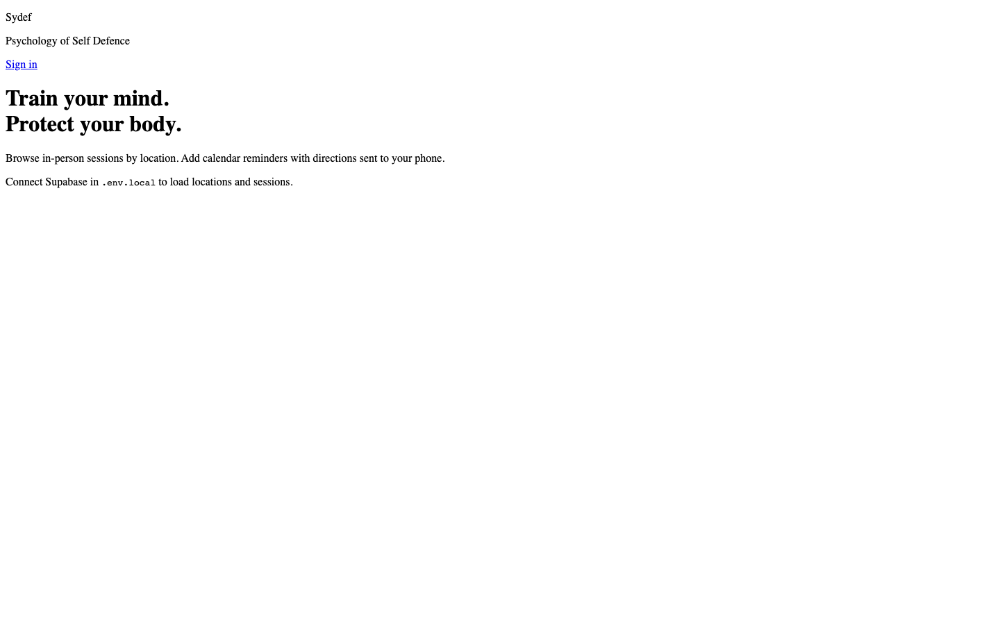
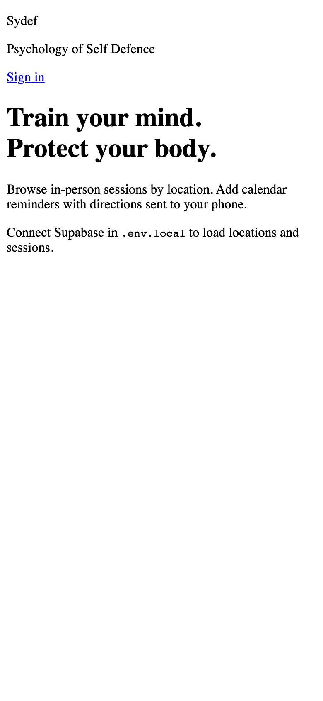
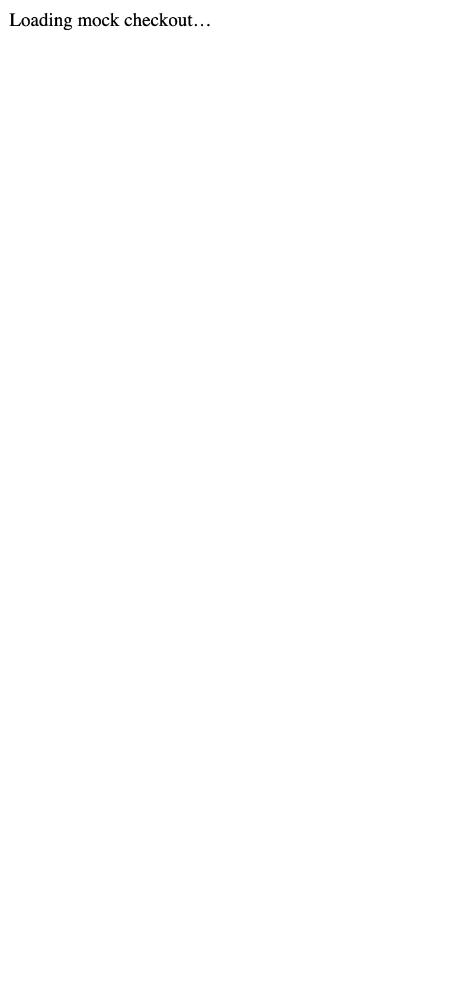
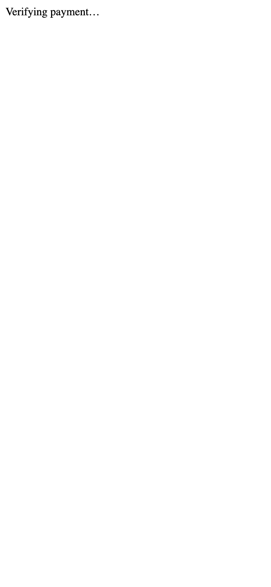
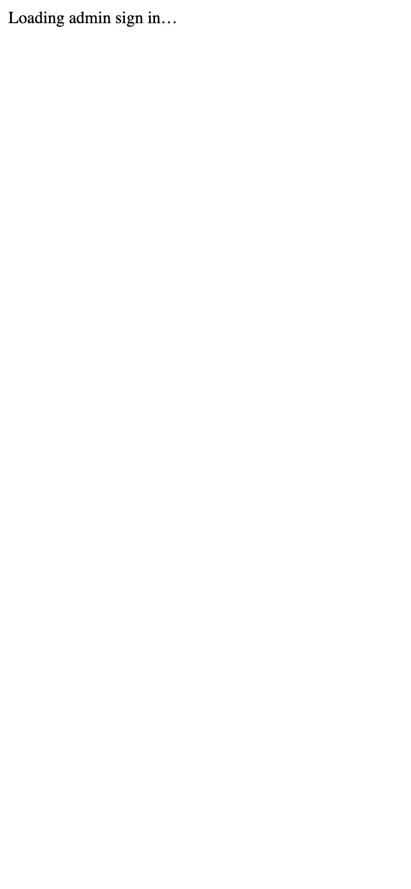
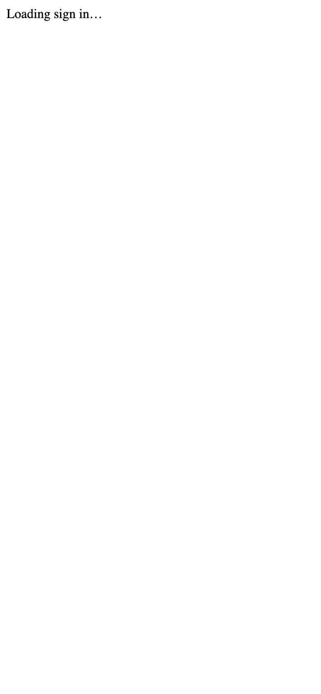

# Sydef — Screenshots

Visual walkthrough of every Sydef screen, captured **2026-06-19**.

Each page is shown in **desktop (1440×900)** and **mobile (390×844)** viewports.

> Screenshots use `SCREENSHOT_MODE=1` with representative mock data for documentation.

## Users & members

### Home — browse locations — Desktop

Route: `/`

### Home — browse locations — Mobile

Route: `/`

### Sign in (phone OTP) — Desktop

Route: `/auth`

### Sign in (phone OTP) — Mobile

Route: `/auth`

### Member portal — Desktop

Route: `/portal`

### Member portal — Mobile

Route: `/portal`

### Payment success (portal) — Desktop

Route: `/portal?payment=success`

### Payment success (portal) — Mobile

Route: `/portal?payment=success`

### Mock checkout — Desktop

Route: `/checkout/mock?reference=mock_demo_001&amount=85000`

### Mock checkout — Mobile

Route: `/checkout/mock?reference=mock_demo_001&amount=85000`

### Checkout callback — Desktop

Route: `/checkout/callback?provider=mock&reference=mock_demo_001`

### Checkout callback — Mobile

Route: `/checkout/callback?provider=mock&reference=mock_demo_001`

## Admin

### Super admin login — Desktop

Route: `/admin/login`

### Super admin login — Mobile

Route: `/admin/login`

### Super admin — verification step — Desktop

Route: `/admin/login?verify=1`

### Super admin — verification step — Mobile

Route: `/admin/login?verify=1`

### Admin dashboard — Desktop

Route: `/admin`

### Admin dashboard — Mobile

Route: `/admin`

### Content CMS — Desktop

Route: `/admin/content`

### Content CMS — Mobile

Route: `/admin/content`

### Analytics — Desktop

Route: `/admin/analytics`

### Analytics — Mobile

Route: `/admin/analytics`

### Financial portal — Desktop

Route: `/admin/financial`

### Financial portal — Mobile

Route: `/admin/financial`

### Bookings — Desktop

Route: `/admin/bookings`

### Bookings — Mobile

Route: `/admin/bookings`

### Super admin settings — Desktop

Route: `/admin/settings/superadmin`

### Super admin settings — Mobile

Route: `/admin/settings/superadmin`

### Platform settings — Desktop

Route: `/admin/settings`

### Platform settings — Mobile

Route: `/admin/settings`

## Corporate & brands

### Corporate packages & brand orders — Desktop

Route: `/admin/corporate`

### Corporate packages & brand orders — Mobile

Route: `/admin/corporate`

